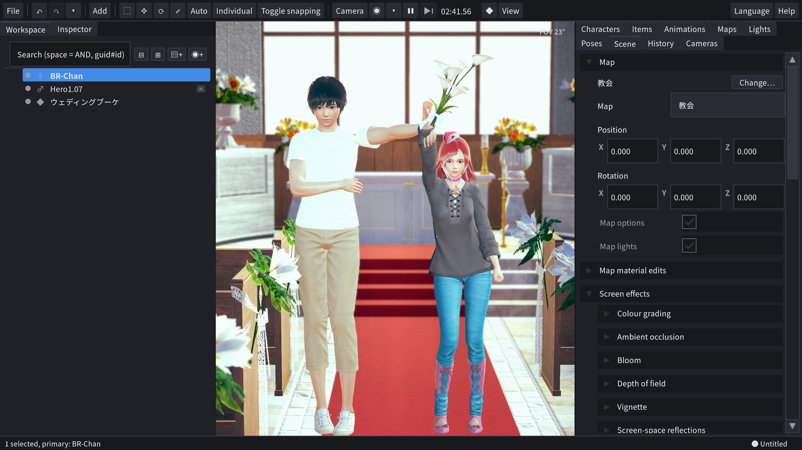
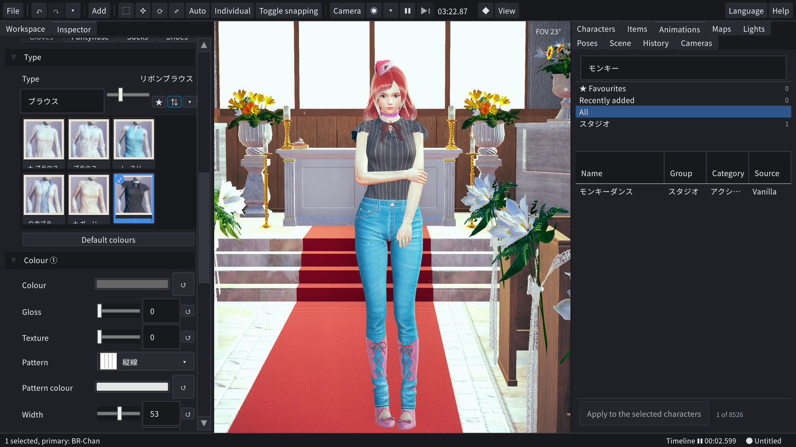
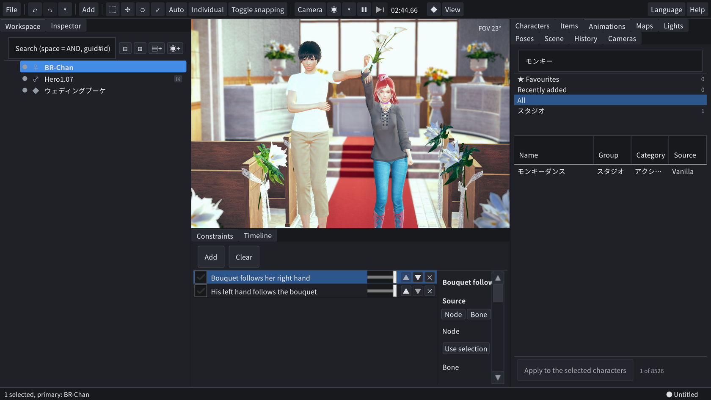
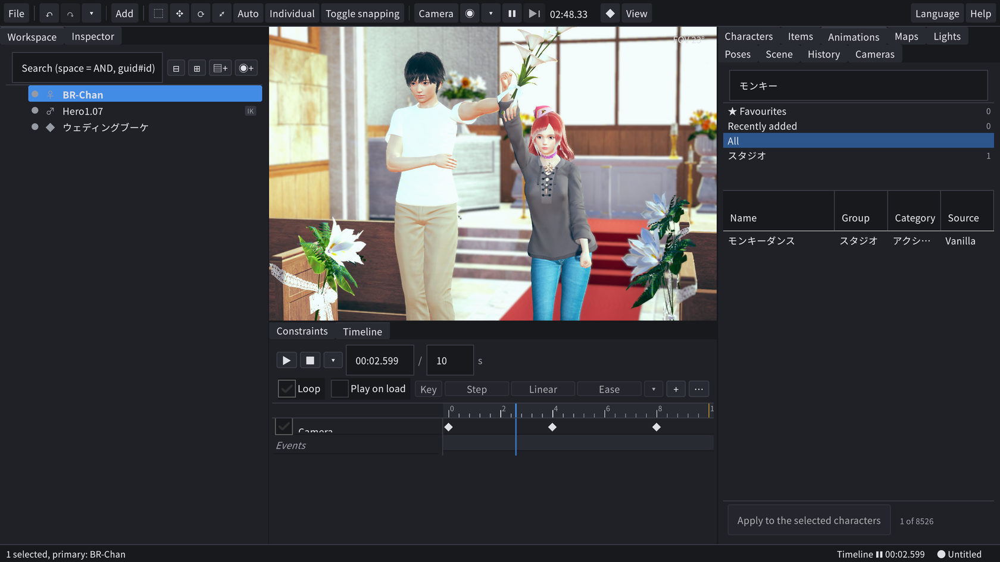

# HS2Next 1.4.0

HS2Next 是一个使用 Honey Select 2 内容的场景与角色编辑器，基于 Unity 6 全新编写。它把 HS2 Studio 的工作和游戏本体
的角色编辑（捏人）放在同一个窗口中：角色、物品、地图、灯光、相机、动画、FK / IK、表情、画面效果，以及脸、身体、
头发、服装和饰品的编辑页面。此外还有时间轴、约束、材质编辑、高级姿势、湿痕与污渍、布娃娃、把角色烘焙为 Studio 物品的
“角色转道具”、切割角色和物品的“切割”，以及保存可重复使用镜头的“场景脚本”。它在原位置读取您自己安装的
Honey Select 2 的游戏数据、角色卡、服装卡、姿势文件和 zipmod，并以 HS2Next 自己的文件格式保存作品。

English: [README.md](README.md) · 日本語: [README_ja.md](README_ja.md)

## 演示视频和截图

1.3.1 版的功能演示（2 分 53 秒，带英文和日文字幕）：[在 YouTube 上观看 HS2Next 1.3.1 Demo](https://www.youtube.com/watch?v=XGbSyt7UOKE)

| 场景：地图、两个角色和一个物品 | 角色编辑：服装页面，列表带收藏 |
| --- | --- |
|  |  |
| **约束：花束跟随她的手，他的手跟随花束** | **时间轴：随场景保存的相机关键帧** |
|  |  |

这些是 HS2Next 的截图，画面中显示的是从 Honey Select 2 安装目录读取的内容。这些内容本身不包含在本仓库中。

## HS2Next 不是什么

- 它不是 Honey Select 2 的 mod 或插件，而是一个独立的程序；BepInEx 插件不能在其中运行。
- 它不是游戏的副本。它不包含任何游戏数据，需要您自己的安装才能显示内容。
- 它不能打开 HS2 的场景文件（HS2 Studio 的 `.png` 场景），也没有游戏的剧情、H 场景和游戏进度。角色、服装和姿势从
  HS2 的文件导入；场景在 HS2Next 中制作。

## 状态

1.0.0 是第一个公开版本。保存格式（版本 1）和插件 API（1.0，语义化版本）已经冻结：之后的 1.x 版本可以读取 1.0 的
文件并加载 1.0 的插件。1.0 具备和缺少的功能见 [CHANGELOG.md](CHANGELOG.md)（英文）。

## 系统要求

- Windows 10 或 11，64 位。
- 支持 Direct3D 12 的显卡。建议 8 GB 显存：最大的地图在程序本身之外还会使用约 2.8 GB。
- 您自己安装的 Honey Select 2（如使用 mod，还需要其 `mods` 文件夹）。HS2Next 用游戏自身的骨架、身体和头部数据组装
  角色，因此没有安装就无法生成角色。
- 缓存所需的可用磁盘空间：起初约 0.3 GB，随着打开修复过的 mod 最多增长到约 10 GB。

## 使用发布版

发布的 zip（`HS2Next-1.4.0-win64.zip`，旁边附有其 SHA-256）就是程序本身。解压到任意位置后启动 `HS2Next.exe`，无需
安装程序。程序没有代码签名，因此 Windows SmartScreen 可能会询问一次（点击“更多信息”，再点击“仍要运行”）。首次运行
向导会依次询问语言、Honey Select 2 文件夹、额外的 mod 文件夹和缓存文件夹，然后建立内容索引（根据 mod 数量和磁盘，
需要几秒到几分钟）。

HS2Next 将设置、您的场景与角色以及缓存保存在 `%USERPROFILE%\AppData\LocalLow\stp3\HS2Next`。在 `HS2Next.exe` 旁边
放一个名为 `portable.txt` 的文件，则改为保存在程序旁边。相机按键、自动化桥接、图形问题和卸载方法见 zip 中的
`README_zh-Hans.txt`。

## 从源代码构建

需要：

- Unity 6000.6.5f1（通过 Unity Hub 安装；Windows 版编辑器包含 Windows 的 Mono player 支持）。
- 运行 `Tools/` 下工具所需的 Python 3（只使用标准库），以及运行脚本所需的 PowerShell 7（`pwsh`）。
- 与上文相同的 Honey Select 2 安装。
- 仅构建示例插件时：能够构建 `netstandard2.1` 的 .NET SDK。

步骤：

1. 克隆本仓库（约 44 MB，其中 25 MB 是四个 Noto Sans CJK 字体文件）。
2. 将 `Config/settings.example.json` 复制为 `Config/settings.local.json`，把 `hs2Root` 设为包含 `abdata` 和 `mods`
   的文件夹。其他键都有默认值，示例文件对每个键都有一行说明。
3. 用 Unity 6000.6.5f1 打开项目。首次导入会创建 `Library/`（约 1.7 GB）并编译所有程序集。在命令行中，
   `& Tools\unity_batch.ps1 -Compile` 可以在不显示编辑器窗口的情况下完成同样的工作。
4. 按下播放：应用在编辑器中启动，数据根目录（设置、`UserData/`、`Cache/`）为项目文件夹。
5. 构建 player：`& Tools\unity_batch.ps1 -Method PlayerBuild.BuildApp -LogName appbuild -TimeoutMin 90` 会生成
   `Builds/App/HS2Next.exe`。`& Tools\package_dist.ps1 -Zip` 把这个经过测试的构建整理为 `Builds/Dist/` 下的发布文件夹
   和 zip（它会检查文件，并加入 README、`LICENSE.txt` 和 `THIRD_PARTY.txt`）。

从脚本启动 Unity 时请使用 `Tools/unity_batch.ps1`：它保证同一时间只有一个 Unity 打开项目，等待可用内存达到 8 GB，并
返回 Unity 的退出码。`python -I Tools/offline_compile.py` 不启动 Unity 即可检查 C# 能否编译（需要先用 Unity 编译过
一次项目）。

## 测试

`Tools/run_tests.ps1 -Quick` 运行日常测试集（约 65 行，大多是无界面的 Unity 任务，另有一些纯 Mono 测试）；`-Full`
加入耗时较长的行，`-Only <id>` 选择行，`-List` 列出行。大多数行需要游戏安装；有些行要与只存在于开发机器上的记录
比较，没有这些记录时这些行报告 WARN 而不是 FAIL。各行的内容、所需条件和报告位置见
[Tools/README_tests.md](Tools/README_tests.md)（英文）。

## 文档

除 README 外，文档均为英文。

| 文档 | 内容 |
| --- | --- |
| [ARCHITECTURE.md](ARCHITECTURE.md) | HS2Next 的结构：内容来源与 ID、保存格式、渲染、运动、UI、桥接、插件、启动、数据文件夹、测试 |
| [Reference/COMMANDS.md](Reference/COMMANDS.md) | 自动化桥接（127.0.0.1:17322 上的 HTTP/JSON）的全部命令，以及如何用脚本操作 HS2Next |
| [Reference/PLUGINS.md](Reference/PLUGINS.md) | 基于 1.3 API 编写插件；插件工具包的三个示例见 [Samples/PluginKit](Samples/PluginKit)，完整的例子见 [Samples/Sequencer](Samples/Sequencer/README.md) |
| [CONTRIBUTING.md](CONTRIBUTING.md) | 构建、测试和贡献规则 |
| [CLEANROOM.md](CLEANROOM.md) | 如何在不复制游戏代码的前提下编写代码 |
| [THIRD_PARTY.md](THIRD_PARTY.md) | 第三方软件、字体和运行时组件，以及为互操作而保留的名称 |
| [CHANGELOG.md](CHANGELOG.md) | 版本记录 |

`Assets/HS2Next/Runtime/` 和 `Assets/HS2Next/Shaders/` 下的文件夹各有自己的 README。

## 条款

- HS2Next 是非官方项目，与 ILLUSION 及其任何继承者均无关联，也未获得其认可或支持。提到“Honey Select 2”只是为了
  说明 HS2Next 读取的是谁的数据。
- HS2Next 不包含任何游戏数据。游戏和 mod 的模型、纹理、动画、列表和角色卡都不在本仓库或发布版中。
- 它在安装位置读取您拥有的 Honey Select 2 及您的 mod。除了在列表中删除您选定的角色、服装或姿势文件时将其移到 Windows
  回收站之外，它从不写入游戏文件夹。
- 制作它的目的是让您已经拥有的角色、服装和社区 mod 能够继续使用。
- 为此，HS2Next 为 mod 和资源包的着色器提供了自己的兼容着色器（名称以 `HS2Next/Compatible/` 开头），并用自己的代码读取
  Sideloader 的 zipmod 包，以及社区插件保存在角色卡、服装卡、姿势文件和这些 mod 包中的数据。两者都不是原作者的作品，也未获得原作者
  的认可或支持；“文件 > 选项 > 高级”的末尾列出了它们。
- Honey Select 2 是面向成年人的游戏。请仅在可以使用该游戏本身的地方使用 HS2Next。
- stp3 借助 AI 编程工具制作了 HS2Next：大部分代码由这些工具编写，stp3 负责确定设计、指导工作并进行检查。stp3 以
  CC0 1.0（[LICENSE](LICENSE)）将这些代码贡献到公有领域：可以自由使用、修改和分发。这不适用于 Honey Select 2、其资产
  或他人的 mod：您用 HS2Next 制作的作品（场景、角色、截图）中包含的这些部分，仍受其权利人的条款约束。
- 发布的 zip 还包含 Unity、Microsoft 和 Mono 项目的运行时组件（引擎、DirectX 12、DirectStorage、.NET 类库），它们
  受各自条款约束，条款列在 [THIRD_PARTY.md](THIRD_PARTY.md) 中；使用 HS2Next 即表示您就这些组件接受这些条款。CC0 只
  适用于 HS2Next 自身的代码。
- HS2Next 按“原样”提供，不附带任何形式的担保。

## 许可

HS2Next 自身的代码：CC0 1.0（[LICENSE](LICENSE)）。附带的 Noto Sans CJK 字体：SIL Open Font License 1.1。
Newtonsoft.Json：MIT。Unity 运行时以及发布 zip 中的其他组件：见 [THIRD_PARTY.md](THIRD_PARTY.md)。
